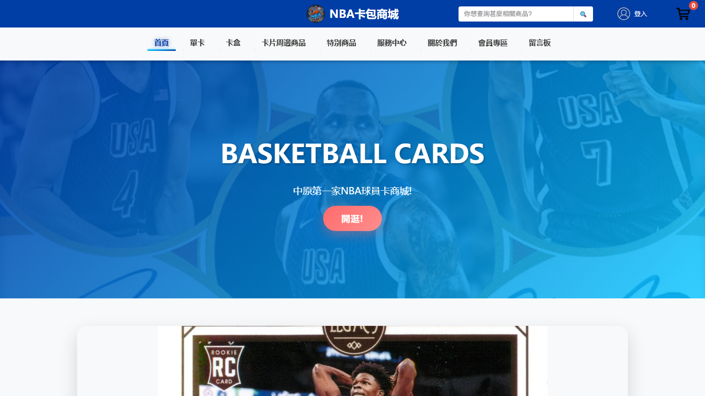
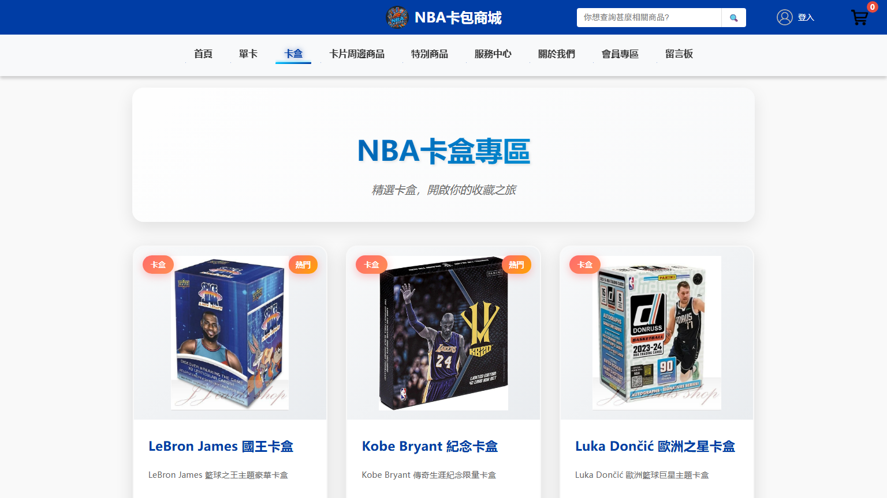
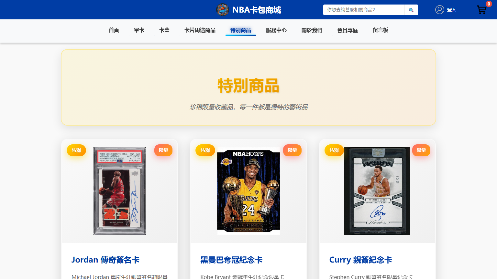
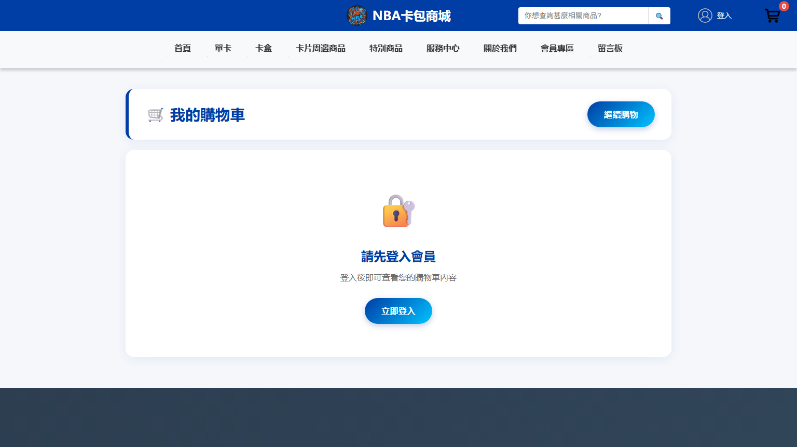
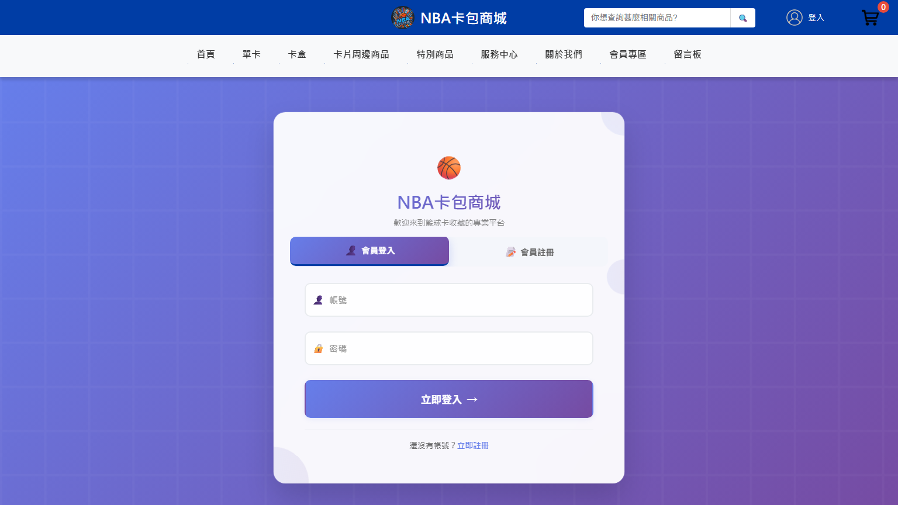
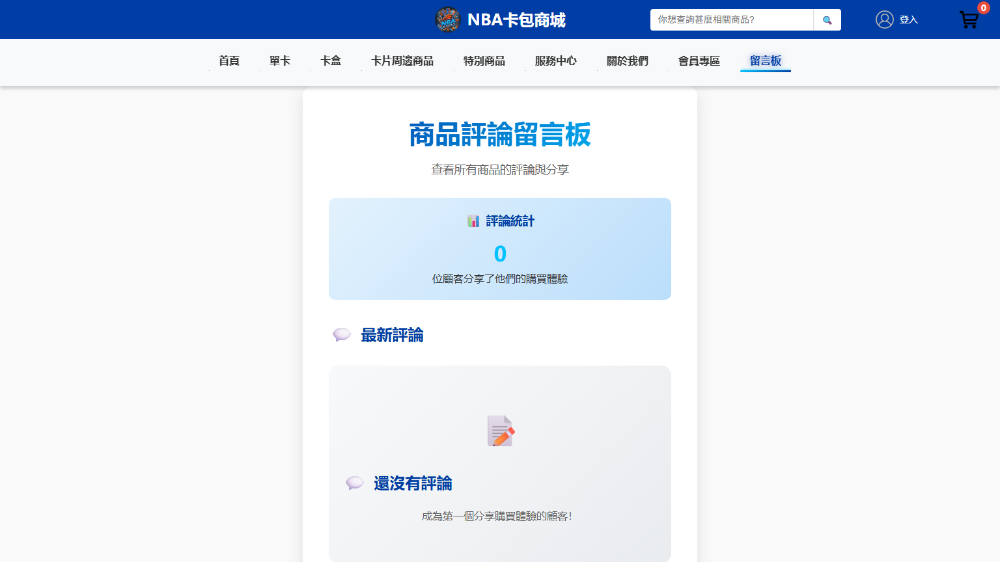
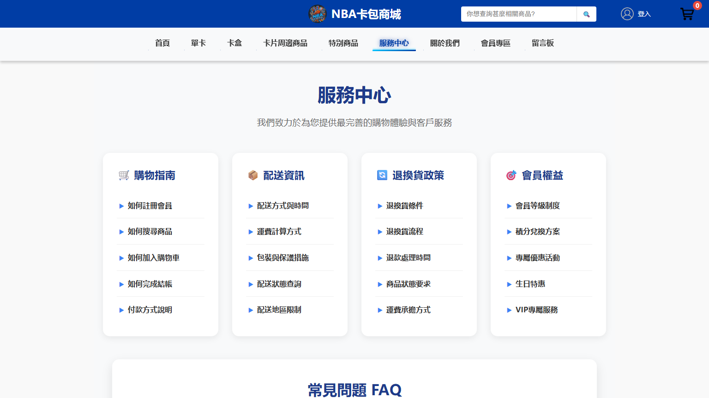
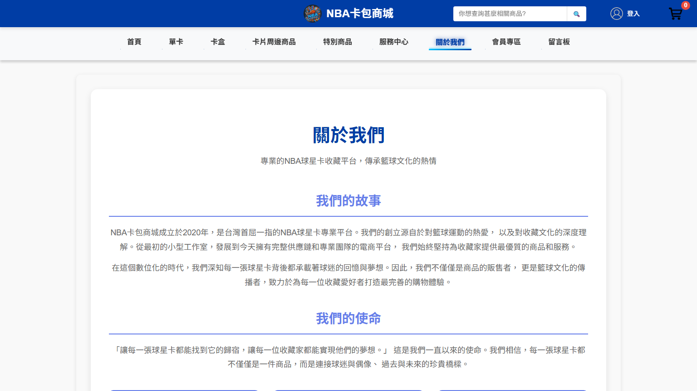

# NBA 卡包商城

2025 年網路程式設計期末專案，以 Java/JSP 搭配 MySQL，提供球員卡、卡盒與周邊商品商城。

包含商品瀏覽、搜尋、會員、購物車、結帳、留言、商品評價及管理後台。

## 系統畫面

### 商城首頁

### 商品瀏覽

| NBA 球員卡 | NBA 卡盒專區 |
| --- | --- |
|  |  |
| **卡片周邊商品** | **特別商品** |
|  |  |

### 商品詳情與購物車

| 商品詳情 | 購物車 |
| --- | --- |
|  |  |

### 會員與評論

| 會員登入 | 商品評論留言板 |
| --- | --- |
|  |  |

### 服務與商城資訊

| 服務中心 | 關於我們 |
| --- | --- |
|  |  |

## 原始碼

- [商城首頁](src/main/webapp/index.jsp)
- [網頁、JSP 後端、CSS 與圖片](src/main/webapp/)
- [管理後台](src/main/webapp/admin/)
- [資料庫結構與展示商品資料](src/main/sql/nba_database_final.sql)

## 執行設定

需要 Java、支援 `javax.servlet` 的 JSP 伺服器（例如 Apache Tomcat 9）、MySQL 和 MySQL Connector/J。商品圖片表單另需 Apache Commons FileUpload 1.6.0 與 Commons IO 2.19.0，請放入應用程式的 `WEB-INF/lib`。此備份未包含伺服器、JAR 或建置設定。

1. 在專用的本機 MySQL 測試環境匯入 SQL。它會建立 `nba_db`，且包含 `DROP TABLE IF EXISTS`，不要對現有重要資料庫直接執行。
2. 在啟動 Tomcat 的環境設定下列變數：

   | 變數 | 用途 |
   | --- | --- |
   | `NBA_DB_URL` | JDBC 網址，例如 `jdbc:mysql://localhost:3306/nba_db?useUnicode=true&characterEncoding=UTF-8&serverTimezone=Asia/Taipei` |
   | `NBA_DB_USER` | 本機 MySQL 使用者 |
   | `NBA_DB_PASSWORD` | 本機 MySQL 密碼 |

3. 將 `src/main/webapp/` 的內容部署到 Tomcat 應用程式目錄，透過應用程式網址開啟 `index.jsp`。

資料庫初始化、批次更新及清理由維護人員透過資料庫工具操作。
4. 歷史會員資料未附入，可由網站註冊測試會員。

## 資安防護

- **跨站請求及網頁輸出**：購物車、評論及結帳等寫入入口要求同源 POST。後台商品、訂單與付款表單另外驗證管理員身分及工作階段專用的 CSRF token。移除接受自訂 JavaScript、CSS 或 JSP include 路徑的舊模板，Servlet 設定也封鎖舊網址。

- **註冊與修改密碼**使用加鹽 PBKDF2-HMAC-SHA256（600,000 次迭代）。登入只接受有效雜湊。舊明文帳號需經身分核對後重設密碼。既有安裝可由管理者備妥帳號復原流程，再執行[舊密碼停用 SQL](src/main/sql/disable_legacy_passwords.sql) 清除不合格式的儲存值。新匯入的展示資料沒有歷史會員密碼。
- **登入成功後**重發 Session ID，Session Cookie 使用 `HttpOnly`，登入後只允許轉往指定商城頁面。
- **訂單清單及詳情**只開放管理員。封鎖會匯入、清理及批次更新資料的維護頁。公開狀態頁只回報整體可用性。

審查入口包括 [密碼處理](src/main/webapp/WEB-INF/member_password.jspf)、[後台 CSRF 檢查](src/main/webapp/WEB-INF/require_admin_csrf.jspf)、[商品狀態寫入](src/main/webapp/admin/admin_product_status_update.jsp) 和 [Servlet 設定](src/main/webapp/WEB-INF/web.xml)。

## 備份範圍

- 保留找到的全部 139 個來源檔案，未重複放入 ZIP 備份、較早的純前端版本或無關課堂練習。
- 原本寫死的 MySQL 連線設定改由環境變數讀取，未上傳原密碼。
- 保留全部資料表結構與商品等展示資料，移除歷史會員、購物車、訂單、積分、留言、評論及相關紀錄，另移除歷史站台設定與統計資料。
- 原始本機檔案未被覆寫。

這是課程專案的原始碼備份。商品頁、會員註冊與登入及商品評論均曾在本機展示環境驗證，正式結帳與完整後台操作仍待驗收。
